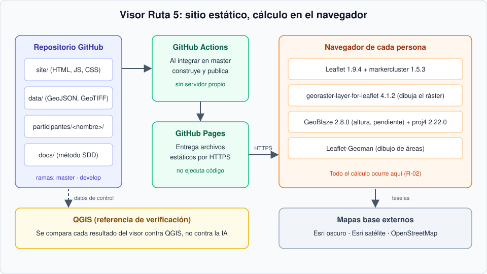

# Visor web de la Ruta 5 en la Región Metropolitana


Material educativo de webmapping con datos reales de la Región Metropolitana de Santiago de Chile, desarrollado bajo Spec-Driven Development (SDD). Un visor estático construido con Leaflet que responde, para una comuna de trabajo, tres preguntas: qué cobertura del suelo hay en un punto, qué altura tiene y qué pendiente tiene un área dibujada.

Desarrollado por [Negentropy Technologies SpA](https://github.com/negentropy-technologies) para una inducción de tres horas en mapas con QGIS y webmapping.

**Estado:** en preparación. El visor, los datos recortados y la publicación en GitHub Pages aún no están disponibles. Este repositorio contiene por ahora el método de trabajo (`docs/`).

## Stack tecnológico


## Contenido

- [Objetivo](#objetivo)
- [Qué hace el visor](#qué-hace-el-visor)
- [Arquitectura](#arquitectura)
- [Tecnología](#tecnología)
- [Datos](#datos)
- [Estructura del repositorio](#estructura-del-repositorio)
- [Metodología: Spec-Driven Development](#metodología-spec-driven-development)
- [Flujo de trabajo y ramas](#flujo-de-trabajo-y-ramas)
- [Cómo ejecutar el visor](#cómo-ejecutar-el-visor)
- [Licencia y atribuciones](#licencia-y-atribuciones)
- [Autoría](#autoría)
- [Referencias](#referencias)

## Objetivo

1. Que cada participante construya una parte de un visor web real, con datos reales y verificables.
2. Que aprenda a trabajar con IA de forma disciplinada: especificar, planificar, implementar una tarea y verificar el resultado contra una referencia (QGIS), no contra la opinión de la IA.
3. Que el repositorio quede como material reutilizable para otros talleres con la misma arquitectura.

## Qué hace el visor

Dentro de la comuna de trabajo (Colina, propuesta):

| Función | Descripción |
|---|---|
| Mapas base | Esri oscuro, Esri satélite y OpenStreetMap, con su atribución |
| Capas | Ruta 5, división político-administrativa, puentes, emergencias, estaciones y remociones en masa, con control de visibilidad y opacidad |
| Cobertura del suelo | Ráster MapBiomas Chile 2024 con leyenda de 16 clases; el clic devuelve la clase |
| Altura | El clic sobre el modelo de elevación devuelve la altura en metros |
| Pendiente | Al dibujar un área, muestra la pendiente media y máxima en grados |

## Arquitectura

Sitio **estático**: el servidor (GitHub Pages) solo entrega archivos y todo el cálculo ocurre en el navegador. No hay servidor ni base de datos propios.



## Tecnología

| Función | Librería | Versión |
|---|---|---|
| Mapa | Leaflet | 1.9.4 |
| Agrupación de puntos | leaflet.markercluster | 1.5.3 |
| Ráster en el mapa | georaster-layer-for-leaflet | 4.1.2 |
| Valor y estadísticas de ráster | GeoBlaze | 2.8.0 |
| Reproyección | proj4 | 2.22.0 |
| Dibujo de áreas | Leaflet-Geoman | 2.20.2 (compatibilidad por confirmar) |

Las versiones son fijas y se mantienen en [`docs/00-parametros.md`](docs/00-parametros.md). La justificación de cada elección está en [`docs/03-plan.md`](docs/03-plan.md).

## Datos

Capas vectoriales en GeoJSON y ráster (GeoTIFF y JPEG 2000) de la Región Metropolitana, en la carpeta [`data/`](data/). El recorte a la comuna de trabajo queda pendiente. La fuente, la fecha y la licencia de cada capa se declaran en [`docs/06-contrato-datos.md`](docs/06-contrato-datos.md); el detalle de contenido y exclusiones, en [`data/README.md`](data/README.md).

| Dato | Descripción |
|---|---|
| Ruta 5 y corredor | Eje de la Ruta 5 y franja de influencia |
| División político-administrativa | Región, provincias y comunas |
| Puentes, emergencias y estaciones | Elementos puntuales de contexto y riesgo |
| Remociones en masa | Puntos de eventos registrados |
| Cobertura del suelo | MapBiomas Chile, 2024, 30 m, 16 clases |
| Elevación | Modelo digital de elevación, altura en metros enteros |

**Aviso:** varias capas no declaran licencia en su fuente. Revise `docs/06-contrato-datos.md` antes de reutilizarlas.

## Estructura del repositorio

```text
.
├── .github/
│   └── pull_request_template.md       Plantilla de pull request con checklist
├── data/                              Datos de la Región Metropolitana
│   ├── geojson/                       17 capas vectoriales (*_rm.geojson)
│   ├── raster/
│   │   ├── dem_metropolitana.tif      Modelo digital de elevación
│   │   └── mapbiomas_2024_rm_32719.jp2  Cobertura del suelo MapBiomas 2024
│   └── README.md                      Contenido y exclusiones
├── docs/                              Método de trabajo (SDD)
│   ├── assets/
│   │   └── arquitectura.svg           Diagrama de arquitectura
│   ├── 00-parametros.md
│   ├── 01-constitucion.md
│   ├── 02-especificacion.md
│   ├── 03-plan.md
│   ├── 04-tareas.md
│   ├── 05-bucle-verificacion.md
│   ├── 06-contrato-datos.md
│   ├── 07-registro-verificacion.md
│   └── README.md                      Introducción y cómo reutilizar el método
├── .editorconfig                      Estilo de edición común
├── .gitattributes                     Fin de línea y archivos binarios
├── .gitignore
├── CONTRIBUTING.md                    Guía de contribución y flujo de ramas
└── README.md
```

Se incorporarán más adelante, y aún no existen en el repositorio: `site/` (núcleo común del visor) y `participantes/<nombre>/` (trabajo de cada participante).

## Metodología: Spec-Driven Development

La especificación es la fuente de verdad y el código es su resultado. El flujo sigue las etapas de constitución, especificación, plan, tareas e implementación, con una verificación que se repite hasta que el resultado cumple los criterios (GitHub, Spec Kit).

| Archivo | Contenido |
|---|---|
| [`docs/README.md`](docs/README.md) | Introducción y cómo reutilizar el método |
| [`docs/00-parametros.md`](docs/00-parametros.md) | Valores del proyecto |
| [`docs/01-constitucion.md`](docs/01-constitucion.md) | Reglas que no se negocian |
| [`docs/02-especificacion.md`](docs/02-especificacion.md) | Historias de usuario y criterios de aceptación |
| [`docs/03-plan.md`](docs/03-plan.md) | Plan técnico |
| [`docs/04-tareas.md`](docs/04-tareas.md) | Tareas por variante |
| [`docs/05-bucle-verificacion.md`](docs/05-bucle-verificacion.md) | Bucle de verificación e instrucciones para la IA |
| [`docs/06-contrato-datos.md`](docs/06-contrato-datos.md) | Contrato de datos |
| [`docs/07-registro-verificacion.md`](docs/07-registro-verificacion.md) | Registro de verificación del participante |

## Flujo de trabajo y ramas

| Rama | Función |
|---|---|
| `master` | Rama por defecto. Publica el sitio en GitHub Pages |
| `develop` | Integración |
| `<nombre>` | Rama individual de cada participante, creada desde `develop` |

1. Clonar el repositorio.
2. Crear su rama desde `develop` con su nombre.
3. Trabajar solo en `participantes/<nombre>/`.
4. Abrir un pull request hacia `develop` con el checklist completo.
5. La persona a cargo revisa y, cuando todo cumple, integra `develop` en `master`.

Detalle en [`CONTRIBUTING.md`](CONTRIBUTING.md).

## Cómo ejecutar el visor

Pendiente de definir cuando exista el núcleo común. El sitio es estático, por lo que se abrirá con un servidor local simple de archivos. Los pasos exactos se agregarán aquí una vez validados.

## Licencia y atribuciones

- **Licencia del repositorio:** por definir. Hasta entonces no se concede un permiso explícito de reutilización.
- **Mapas base:** cada mapa base muestra la atribución que exige su proveedor.
- **Datos:** la fuente y las condiciones de cada capa se registran en el contrato de datos. MapBiomas Chile se cita como fuente de la cobertura del suelo.

## Autoría

Negentropy Technologies SpA. Responsable del proyecto: Christian Chacón Romero ([@chachr81](https://github.com/chachr81)).

## Referencias

- GitHub (2025). Spec Kit. https://github.com/github/spec-kit
- GitHub Blog (2 de septiembre de 2025). Spec-driven development with AI: Get started with a new open source toolkit. https://github.blog/ai-and-ml/generative-ai/spec-driven-development-with-ai-get-started-with-a-new-open-source-toolkit/
- Fowler, M. (2016). Serverless Architectures. https://martinfowler.com/articles/serverless.html
- IETF (2016). RFC 7946, The GeoJSON Format. https://datatracker.ietf.org/doc/html/rfc7946
- MapBiomas Chile. https://chile.mapbiomas.org
